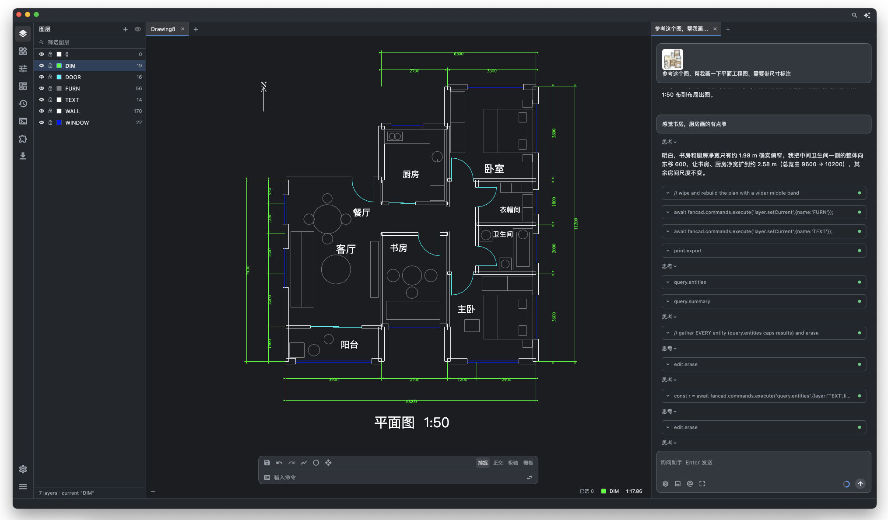

<p align="center">
  
</p>

<p align="center">
  <strong>FanCAD</strong> AI原生的专业 2D CAD 软件。
</p>

<p align="center">
  <a href="https://github.com/sjjian/FanCAD/stargazers"></a>
  
  
  
  
  
</p>

<p align="center">
  
</p>

<p align="center">
  <sub>注：该示例图完全由 AI 生成，使用的模型是 deepseek-v4.1-flash-1017。</sub>
</p>

<p align="center">
  <a href="./README.md">English</a> | <b>简体中文</b>
</p>

## 为什么做
1. 我需要深度使用 CAD，每天要接触几十张图纸；
2. AI 编码能力越来越强，开发和打磨一款 CAD 已经可行，而传统 CAD 软件都收费；
3. 传统 CAD 界面过于复杂，我参考 VS Code 的理念做了这款，把使用体验简化了；
4. 没有一款比较好的原生 AI 产品。我希望内置一个符合日常使用的深度集成，满足我日常使用；

## 特性
1. 支持DWG, DXF格式；
2. 深度集成AI助手；
3. 支持对外提供 MCP；
4. 支持 Windows、macOS、Linux；
5. 支持插件系统，且可以由 AI Chat 自行添加插件。

## 构建

```bash
git clone --recurse-submodules git@github.com:sjjian/FanCAD.git
cd FanCAD
git submodule update --init --recursive
flutter pub get
flutter run -d macos
```
